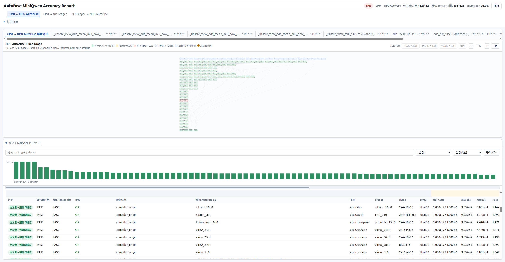
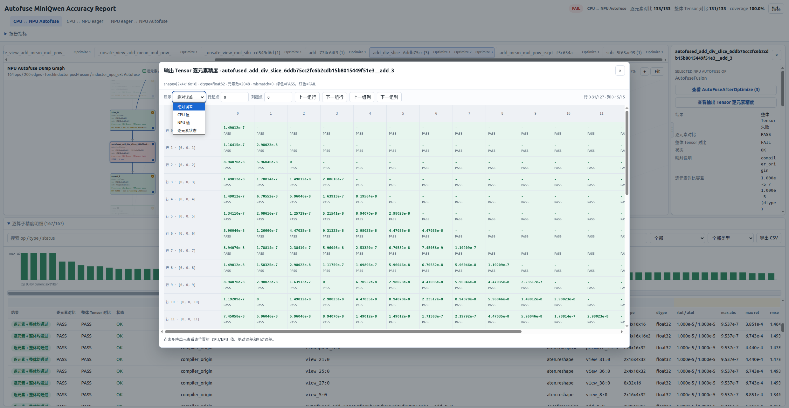
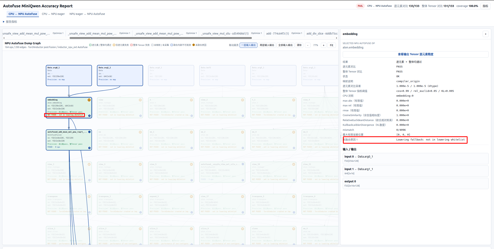
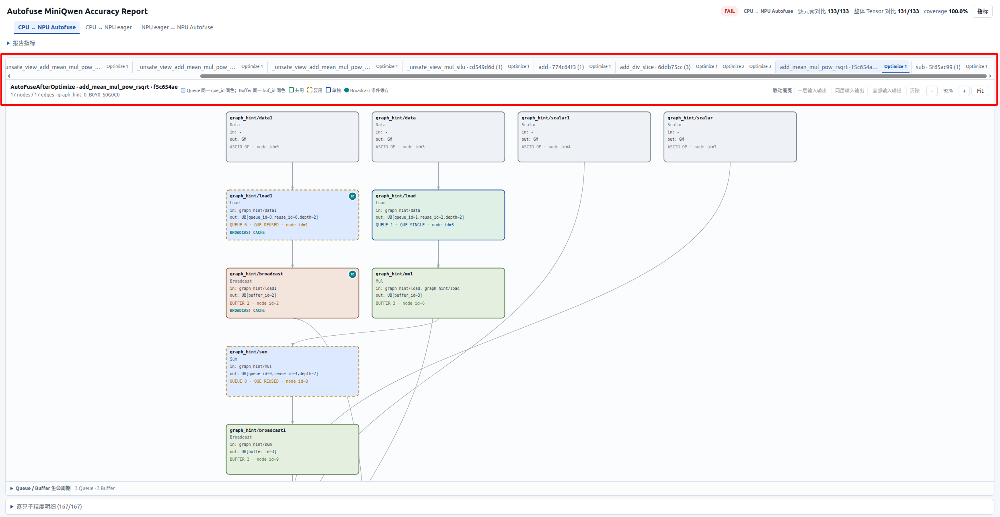

# Autofuse Debugger 功能展示

本文档用真实报告截图说明当前工具的主要功能。截图来自远端 NPU 环境执行的：

```text
/mnt/workspace/gitCode/cann/graph-autofusion/autofuse/examples/af_qwen/af_qwen.py
```

报告由 Inductor pre-fusion `CPU`、同一张 pre-fusion FX 图的 `NPU eager` 和 `NPU Autofuse` 三条执行路径共同生成。示例截图中的具体数值属于该次运行结果，实际模型和输入变化后会随报告更新。

## 1. 三方精度对比

运行 `run-script` 后，报告顶部提供三组对比页签：

- `Inductor pre-fusion CPU ↔ NPU Autofuse`：默认视图，用于观察 Autofuse 相对 pre-fusion CPU 的精度结果。
- `Inductor pre-fusion CPU ↔ Inductor pre-fusion NPU eager`：用于区分 NPU 单算子执行与 CPU 的差异。
- `Inductor pre-fusion NPU eager ↔ NPU Autofuse`：用于定位误差是否由 Autofuse 融合引入。

切换页签时，顶部统计、主图、算子明细表和算子名称会同步切换。



报告中保留三份 manifest：

```text
cpu_manifest.json
npu_eager_manifest.json
npu_manifest.json
```

也可以使用已有 manifest 单独生成三方报告：

```bash
python3 -m autofusedebugger compare-three \
    --cpu-manifest /path/cpu_manifest.json \
    --npu-eager-manifest /path/npu_eager_manifest.json \
    --npu-autofuse-manifest /path/npu_manifest.json \
    --out /tmp/three_way_report.json \
    --html /tmp/three_way_report.html
```

## 2. 逐元素 Tensor 精度

对有可比较输出 dump 的节点，主图节点右下角会显示蓝色 `T` 按钮。点击后打开 Tensor 查看器；在节点详情抽屉中也可以点击“查看输出 Tensor 逐元素精度”。

查看器支持：

- 绝对误差、CPU 值、NPU 值和逐元素状态四种显示模式。
- 绿色单元格表示满足逐元素 `rtol/atol`，红色单元格表示失败。
- 点击单元格查看完整坐标、CPU 值、NPU 值、绝对误差和相对误差。
- 多维 Tensor 按“前面维度合并为行、最后一维为列”展开为二维矩阵。
- 行窗口和列窗口分页，避免大 Tensor 一次性创建过多页面元素。



逐元素数据在比较阶段从 CPU/NPU dump 生成并写入报告，因此旧报告需要重新执行比较流程后才会出现 `T` 按钮。

## 3. 未融合原因

Autofuse 主图中存在未融合原因的节点会显示 `NF` 标记。点击节点后，详情抽屉中会展示具体原因，例如：

- lowering whitelist 中没有对应算子。
- 编译器插入的 implicit fallback。
- 非连续 stride 导致性能评估不适合融合。

详情中的 `未融合原因` 与编译器诊断记录对应，不是根据节点名称推测的结果。



## 4. AutoFuseAfterOptimize 图

当 AscendC 后端生成 `AutoFuseAfterOptimize` dump 时，报告会按照融合 kernel 分组展示对应页签，并为同一个融合 kernel 下的多个优化版本提供独立页签。

每张图使用 dump 文件中的真实拓扑和节点输入关系，不根据 dump 文件名简单拼接边。进入融合图后，可以查看内部节点、输入输出 dtype/shape，以及 compiler inserted 节点。



## 5. TQue/TBuf 生命周期

打开任意 `AutoFuseAfterOptimize` 图下方的 `Queue / Buffer 生命周期` 面板，可以查看：

- Queue 生命周期：纵轴为 Queue 实例，横轴为拓扑节点顺序。
- Buffer 生命周期：纵轴为 Buffer 实例，横轴为拓扑节点顺序。
- `共用`、`复用`、`单独使用` 三类 Queue 状态。
- 生产节点和直接消费节点。
- Queue/Buffer 资源颜色与 dump 图中的资源颜色保持一致。
- 可分别选择 `Queue`、`Buffer` 或 `全部`，并对横轴进行缩放。

图中的虚线区间表示按照生产节点、消费节点和资源使用关系推导出的静态生命周期区间，不代表硬件运行时的精确时间轴。


## 6. 一键生成报告

通用 PyTorch 脚本使用方式：

```bash
python3 -m autofusedebugger run-script \
    --framework pytorch \
    --backend inductor_autofuse \
    --script /path/to/model.py \
    --out-dir /tmp/model_accuracy \
    --html /tmp/model_accuracy.html
```

该命令会自动完成：

1. 捕获模型和输入。
2. 从同一次 Inductor 编译中取得 pre-fusion transformed FX 图及真实 AOT 输入，在 CPU 上回放并采集输出。
3. 在 NPU eager 上回放同一张 pre-fusion FX 图并采集输出。
4. 在 NPU 上执行 Inductor + Autofuse 并采集输出。
5. 采集 `AutoFuseAfterOptimize` 图和 Queue/Buffer 信息。
6. 生成三方精度 JSON、CSV 和 HTML 报告。

### 示例报告

Qwen 示例报告：

```text
/tmp/autofuse_qwen_three.html
```

BF16 Add Chain 三方示例报告：

```text
/tmp/autofuse_three_bf16.html
```
