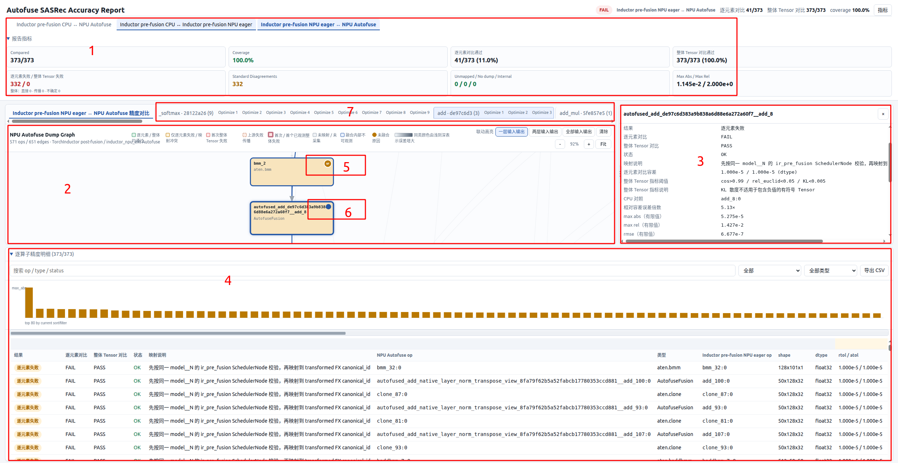
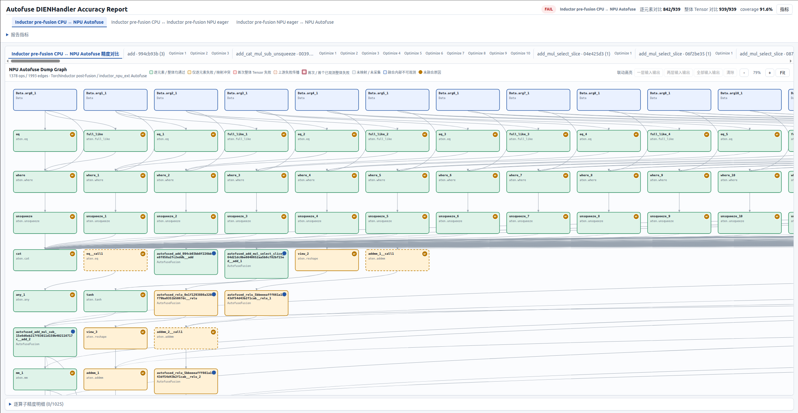
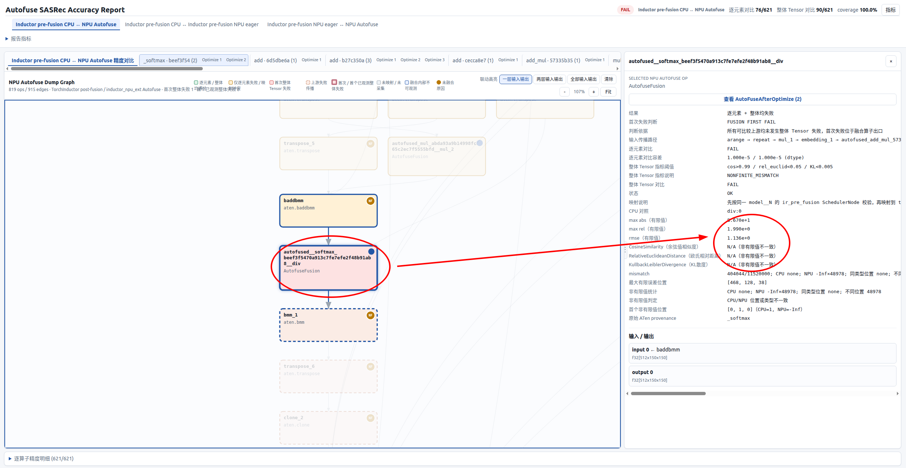
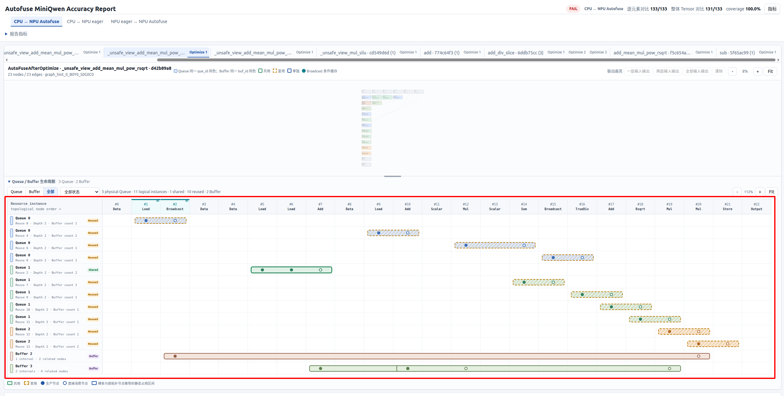
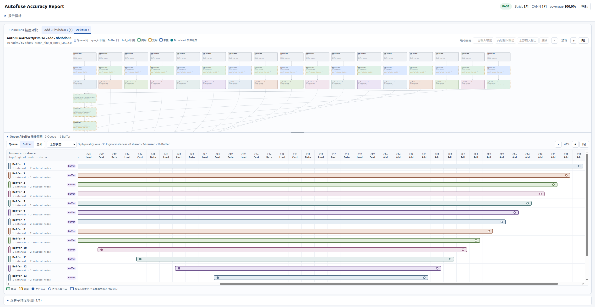

# Autofuse Debugger 功能展示

本文档用真实报告截图说明当前工具的主要功能。

## HTML 报告结构速览

拿到 HTML 报告后，可以按下面的区域快速理解各部分的作用：

1、**顶部摘要和对比页签**：查看整体通过率、失败数量和覆盖率，并在 CPU/NPU Autofuse、CPU/NPU eager、NPU eager/NPU Autofuse 三组结果之间切换，具体见下述第1点。

2、**CPU&NPU 精度对比主图**：以 NPU Autofuse 的真实 post-fusion 拓扑为主，直观查看算子结构、精度状态、未融合标记和首次失败位置。 

3、**节点详情抽屉**：点击节点查看算子映射关系、输入输出的 dtype/shape、精度指标、未融合原因和相关 AutoFuse 图。

4、**逐算子精度明细**：以表格集中查看每个已映射算子的逐元素指标和整 Tensor 指标，便于排序、筛选和定位异常算子。

5、**单算子未融合原因**：每个展示的单算子的右上角都有一个NF标记，点击进去可以看到其未融合原因，具体见下述第3点。

6、**融合子图**：点击融合节点右上角的蓝色入口，在独立视图中查看该融合算子内部的小算子结构。

7、**AutoFuseAfterOptimize 图**：查看 AscendC 后端同一次编译生成的优化后 ASCIR 图，并分析节点之间的 Queue/Buffer 使用关系，具体见下述第4点。

8、**输出 Tensor 逐元素查看器**：在启用 `--save-elementwise-data` 后，每个展示算子的右下角会有一个T标记，点击进去可以查看单个输出 Tensor 每个位置的 CPU/NPU 值、误差和 PASS/FAIL 状态，具体见下述第2点。

9、**Queue / Buffer 生命周期**：按拓扑节点顺序展示资源的生产、消费、共用和复用区间，辅助分析片上内存资源占用，具体见下述第5点。

## 1. 三方精度对比

运行 `run-script` 后，报告顶部提供三组对比页签：

- `Inductor pre-fusion CPU ↔ NPU Autofuse`：默认视图，用于观察 Autofuse 相对 pre-fusion CPU 的精度结果。
- `Inductor pre-fusion CPU ↔ Inductor pre-fusion NPU eager`：用于区分 NPU 单算子执行与 CPU 的差异。
- `Inductor pre-fusion NPU eager ↔ NPU Autofuse`：用于定位误差是否由 Autofuse 融合引入。

切换页签时，顶部统计、主图、算子明细表和算子名称会同步切换。

- 精度对比pass

- 精度对比failed

## 2. 逐元素 Tensor 精度

调用工具时设置`--save-elementwise-data`参数后，主图节点右下角会显示蓝色 `T` 按钮。点击后打开 Tensor 查看器；在节点详情抽屉中也可以点击“查看输出 Tensor 逐元素精度”。

查看器支持：

- 绝对误差、CPU 值、NPU 值和逐元素状态四种显示模式。
- 绿色单元格表示满足逐元素 `rtol/atol`，红色单元格表示失败。
- 点击单元格查看完整坐标、CPU 值、NPU 值、绝对误差和相对误差。
- 多维 Tensor 按“前面维度合并为行、最后一维为列”展开为二维矩阵。
- 行窗口和列窗口分页，避免大 Tensor 一次性创建过多页面元素。

逐元素数据在比较阶段从 CPU/NPU dump 生成并写入报告，因此旧报告需要重新执行比较流程后才会出现 `T` 按钮。

## 3. 未融合原因

Autofuse 主图中存在未融合原因的节点会显示 `NF` 标记。点击节点后，详情抽屉中会展示具体原因，例如：

- lowering whitelist 中没有对应算子。
- 非连续 stride 导致性能评估不适合融合。

详情中的 `未融合原因` 是从debug日志中抓取的结果。

## 4. AutoFuseAfterOptimize 图

当 AscendC 后端生成 `AutoFuseAfterOptimize` dump 时，报告会按照融合 kernel 分组展示对应页签，并为同一个融合 kernel 下的多个优化模版提供独立页签。

每张图使用 dump 文件中的真实拓扑和节点输入关系。进入融合图后，可以查看内部节点、输入输出 dtype/shape等。

## 5. TQue/TBuf 生命周期

打开任意 `AutoFuseAfterOptimize` 图下方的 `Queue / Buffer 生命周期` 面板，可以查看：

- Queue 生命周期：横轴为拓扑节点顺序，纵轴为 Queue 实例。
- Buffer 生命周期：横轴为拓扑节点顺序，纵轴为 Buffer 实例。
- `共用`、`复用`、`单独使用` 三类 Queue 状态。
- 生产节点和直接消费节点。
- Queue/Buffer 资源颜色与 dump 图中的资源颜色保持一致。
- 可分别选择 `Queue`、`Buffer` 或 `全部`，并对横轴进行缩放。

图中的虚线区间表示按照生产节点、消费节点和资源使用关系推导出的静态生命周期区间，不代表硬件运行时的精确时间轴。

例如下面这个报告中的buffer生命周期就是有问题的，每个buffer实例的生命周期都很长

