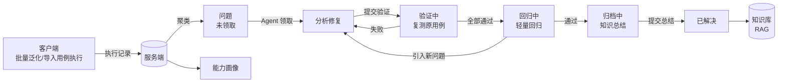

# AutofuseX 一站式开发平台：业务与数据设计（v3）

状态：持续演进中。目标是把 autofusex 从"fuzz 测试平台"升级为"基于 Agent 的 Autofuse 一站式开发平台"；第 8 节起记录的 P0/P1 已实现并在用（[afx-repair skill](../../skills/afx-repair/SKILL.md) 把本文件第 5、8 节当作当前 API 参考），第 9 节"分期计划"中标为未完成的部分仍是设计稿，不代表已有接口。其余章节（业务闭环、状态机、数据库设计、页面设计）是当前实现与后续迭代共用的设计依据，不是一次性草案。

本次按新产品开发：从空库部署，不迁移历史数据，不保留旧接口、旧页面或旧协议的兼容层。现有代码中可复用的部分（租约、幂等 request_key、复测客户端协议、client.update）按新设计重写接入。

## 1. 业务闭环



| 模块 | 职责 | 本期 |
|---|---|---|
| 问题发现 | 客户端生成/导入用例，多 backend 执行，以 CPU（其次 EagerNPU）为基准比较功能、精度、性能，上报 | 实现 |
| 问题修复 | 服务端按 功能/精度/性能 细粒度聚类，Agent 一次领取**一类**问题 | 实现 |
| 验证回归 | 复测问题涉及用例 → 挑选原本正常的用例轻量回归 | 实现 |
| 知识总结 | 回归通过后 Agent 提交结构化知识，关联问题 | 实现 |
| 能力画像 | af-legacy / af-mlir 对比其他 backend 的性能特征分布 | 实现 |
| 导入用例 | Baize（TF/Torch）用例导入，复用执行流程 | 预留字段与接口 |
| 整网分析 | 推荐模型 / LLM 整网执行与分析 | 预留接口与独立表 |
| 用户登录 | 离线发放 token，客户端/Agent/网页唯一凭证 | 实现 |

## 2. 问题状态机

用户描述的五站映射为 6 个持久状态 + 2 个终止状态。页面"地铁站"展示 `领取 → 验证 → 回归 → 总结 → 关闭` 五站，`未领取` 为起点。

| 状态 | 含义 | 进入条件 | 离开 |
|---|---|---|---|
| `open` 未领取 | 聚类新建或租约过期回收 | 聚类产生 / 释放 / 租约过期 | Agent 领取 |
| `claimed` 修复中 | 已被某用户的某 Agent 持有（带租约） | claim | 提交验证 / 释放 |
| `verifying` 验证中 | 服务端已为涉及用例下发复测，客户端执行中 | Agent 调用"验证回归" | 全通过→`regressing`；任一失败→`claimed`（保留轮次记录） |
| `regressing` 回归中 | 服务端挑选回归集并下发，客户端执行中 | 验证通过自动进入 | 全通过→`summarizing`；出现新失败→`claimed`（失败用例记在本轮回归结果中，不另建问题，见 8.2） |
| `summarizing` 归档中 | 等待 Agent 提交知识总结 | 回归通过 | 提交总结→`resolved` |
| `resolved` 已解决 | 闭环完成，剩余人工合入代码 | 知识已关联 | 若同签名在新版本再次出现→`reopened` 新轮次 |
| `closed` 关闭 | 不修复 / 重复 / 误报（管理员操作，需理由） | 人工 | — |

约束：

- 状态迁移只能由服务端事务完成，记录到 `issue_events`；网页操作不能绕过 Agent 租约（沿用现有 repairs 租约/lease_id/request_key 语义）。
- 一个问题的"验证"和"回归"都是**轮次**（`issue_rounds`），失败不覆盖历史，页面可回看每轮。
- 复测必须声明待测版本（graph-autofusion 包版本 + sha256），客户端执行时校验已安装版本一致，否则该复测结果判为无效而不是失败。版本更新由 Agent 通过 skill 在复测客户端上完成。
- 一个 Agent 实例同时只持有一个活动问题；一个用户可多个 Agent 实例。
- 验证和回归只在问题实际出现的 NPU arch 上执行（`issue_cases` 中受影响执行记录的 arch 集合），复测任务只派发给这些 arch 的在线客户端。

### 2.1 回归用例挑选策略

回归集 = **指定用例** + 以下四层自动挑选，按预算合并去重。默认预算 100，管理员可在"平台运维 → 设置"页面调整（全局默认值、单问题上限、四层占比），保存到 `platform_settings`。指定用例不占预算。

1. **特征邻域（50%）**：与问题用例共享主要算子类别 / 融合模式 / dtype，且当前该 backend 为 Pass 的用例。按"共享特征数"排序取前 N，最可能被修复改动影响。
2. **哨兵集（20%）**：平台维护的固定集合，覆盖每个算子类别 × 主要 dtype × 静态/动态，至少各 1 例，定期由管理员刷新。保证每次回归都有全局最低覆盖。
3. **历史已修复用例（20%）**：已解决问题的代表用例（每个问题取 1–3 个），防止老问题复发。
4. **分层随机（10%）**：其余 Pass 用例按算子类别分层随机，随机种子写入轮次记录，保证可复现。

**指定回归用例**：人工在页面上或 Agent 调用 API，把特定用例标记为必选回归用例，分两种范围：

| 范围 | 作用 | 典型用法 |
|---|---|---|
| 全局（`scope=global`） | 所有问题的回归都必须包含 | 关键模型子图、历史高价值用例；即哨兵集的人工部分 |
| 特征（`scope=feature`，如 `op_category=reduce`） | 问题用例带该特征时必须包含 | 某类算子的标准回归用例 |
| 单问题（`scope=issue`） | 只对该问题的回归生效 | Agent 根据修改范围判断"这几个用例最可能被影响" |

指定用例存放在 `regression_pins(pin_id, scope, scope_value, case_id, added_by, reason, created_at, revoked_at)` 中。单问题的指定只能在问题进入 `regressing` 之前提交（由租约持有者或管理员提交），提交后冻结。页面入口：问题发现页选中用例后点"加入回归集"；问题详情抽屉中有"指定回归用例"。

挑选结果冻结在 `issue_cases(role='regression', pick_reason=pinned|neighbor|sentinel|history|random)` 中。回归判定：回归集中原 Pass 用例变为非 Pass 即回归失败；原本就不稳定（历史上同版本结果翻转过）的用例标记 `flaky`，不阻塞但在页面提示（P1 尚未实现 flaky 识别）。

## 3. 用例标识

`cases` 表内部用 INTEGER 主键 `case_id`，对外唯一键 `case_key`：

| 来源 `case_source` | `case_key` 规则 | 说明 |
|---|---|---|
| `nnsmith` | 十进制 seed（约 50 位，高位区分静态/动态） | 可由 seed 重建图与输入，图不会变 |
| `baize_tf` / `baize_torch` | `B:` + Baize 用例全名（如 `B:torch/ops/test_add_bf16_001`） | 不推算 seed；seed 是纯数字，带 `B:`/`M:` 前缀的 ID 不会和 seed 冲突 |
| `model`（整网预留） | `M:` + 模型名 + 配置摘要 | 不进入 fuzz 统计 |

不建议为 Baize 用例"推算 seed"：seed 是生成参数的编码，固定图无法反推。改为两层身份：

- `case_key`：业务唯一 ID（来源决定格式）；
- `graph_fingerprint`：规范化计算图（算子、属性、shape、dtype、拓扑）的 SHA-256。同图的泛化用例与 Baize 用例可以据此关联、去重统计，但不合并为一条用例。

**导入用例的图更新**：同一 `case_key` 再次导入时，如果 `graph_fingerprint` 变了，就用新图覆盖 `cases` 这一行（构图、输入、特征全部替换），并把 `case_revision` 加 1。旧图的执行记录不会被重新解释成新图的结果，处理如下：

1. `executions.case_revision` 记录每次执行对应的版本。覆盖时，该用例的执行头和统计聚合中旧版本的贡献在同一事务内扣除，用例回到"未执行"状态，等待重新执行。
2. 旧版本执行记录保留为历史，页面上显示"旧图"标记，不参与统计和聚类。
3. 如果旧版本用例正关联在未关闭的问题上，该关联标记为 `stale`，并在问题事件中记一笔；修复验证只针对当前版本执行。
4. 指纹没变的重复导入不做任何修改（幂等）。

## 4. 数据库设计

约定：内部关联一律 INTEGER；版本、环境等低基数长字段进维度表；日志等大文本进冷内容表按内容哈希去重；JSON 只放确实无需查询的扩展字段。

### 4.1 表一览

| 表 | 粒度 | 预估行数（100 万用例） |
|---|---|---|
| `users` / `user_tokens` | 用户 / 凭证 | 百级 |
| `cases` | 用例 | 1M |
| `case_features` | 用例 × 特征标签（算子类别、dtype、融合模式） | ~5M，窄表 |
| `case_metrics` / `feature_registry` | 用例连续特征 / 特征注册表 | ~10M 窄表 / 几十行 |
| `regression_pins` | 人工或 Agent 指定的必选回归用例 | 百～千级 |
| `platform_settings` | 回归预算、性能持平阈值等可在页面调整的配置 | 几十行 |
| `schema_migrations` | 迁移版本 | — |
| `environments` | 执行环境维度（全部版本号 + OS/CPU/GCC） | 千级 |
| `runs` | 一次提交的批次（任务/复测/回归轮次） | 万级 |
| `executions` | 用例 × backend × 一次执行 | 3M+（随复测增长） |
| `execution_shapes` | 执行 × shape（动态用例多 shape） | ~9M，窄表 |
| `execution_heads` | 每个 (case, backend, npu_arch) 的最新有效执行指针 | ~3M，极窄 |
| `contents` | 日志、诊断、case_spec，按 SHA-256 去重压缩 | 视重复度 |
| `issues` / `issue_cases` / `issue_rounds` / `issue_events` | 问题及其生命周期 | 千～万级 |
| `knowledge` / `knowledge_links` | 知识条目与关联 | 千级 |
| `clients` | 客户端（机器 + 用户 + 已安装版本） | 百级 |
| `metric_rollups` | 平台效率按小时汇总 | 每客户端每小时一行 |
| `stat_buckets` / `perf_pair_buckets` | 增量维护的统计与 backend 两两对比聚合 | 万级 |
| `import_sources`（预留） | Baize 导入批次 | — |
| `model_jobs` / `model_reports`（预留） | 整网分析 | — |

### 4.2 用户与凭证

```sql
users(
  user_id TEXT PRIMARY KEY,          -- 登录名，离线分配
  display_name TEXT,
  role TEXT NOT NULL,                -- admin | developer | viewer
  status TEXT NOT NULL,              -- active | disabled
  created_at, last_seen_at
)
user_tokens(
  token_id INTEGER PRIMARY KEY,
  user_id TEXT NOT NULL REFERENCES users,
  token_prefix TEXT NOT NULL,        -- 前 8 位明文，便于识别/吊销
  token_hash BLOB NOT NULL UNIQUE,   -- HMAC-SHA256(server_secret, token)
  expires_at, revoked_at, created_at, last_used_at
)
```

- token 为 32 字节随机数，只在发放时显示一次；高熵随机 token 用带服务端密钥的 HMAC 即可，不必用慢哈希。
- 每个用户只有一个 token：客户端脚本、Agent、浏览器都用同一个，鉴权只看该 token 所属用户的 `role`（`admin` 可做一切；`developer` 可读写；`viewer` 只能读）。不再区分 token 种类或单独的权限范围（scope）——早期设计按 client/agent/web 签发不同 token 并各自限定 scope，实践中这些 scope 集合几乎重叠，只增加了需要记住的概念，所以去掉了。重新 `token issue` 会吊销该用户之前的 token。
- 离线发放：`afx server user add / token issue / token revoke` 管理命令。

### 4.3 用例 `cases`

```sql
cases(
  case_id INTEGER PRIMARY KEY,
  case_key TEXT NOT NULL UNIQUE,      -- seed 或 B:/M: 前缀 ID
  case_source TEXT NOT NULL,          -- nnsmith | baize_tf | baize_torch | model
  case_revision INTEGER NOT NULL DEFAULT 1,  -- 图更新时 +1
  graph_fingerprint BLOB,             -- 规范化图 SHA-256
  is_dynamic INTEGER NOT NULL,
  shape_count INTEGER NOT NULL,
  node_count INTEGER, op_types TEXT,  -- 展示用，检索走 case_features
  max_dim INTEGER, max_numel INTEGER, dtypes TEXT,
  spec_content_id INTEGER REFERENCES contents,  -- CaseSpec / 导入的构图+输入描述
  import_source_id INTEGER,           -- 预留：Baize 导入批次
  external_ref TEXT,                  -- 预留：Baize 原始路径/用例名
  first_seen_at
)
case_features(case_id, kind, value_id, PRIMARY KEY(case_id, kind, value_id))
-- 离散特征（多标签）：op_category | op | dtype | fusion_pattern | rank | size_bucket ...
case_metrics(case_id, metric_id, value REAL, PRIMARY KEY(metric_id, case_id))
-- 连续特征：node_count | max_numel | reduce_ratio | fusion_chain_len ...，供画像散点坐标轴
feature_registry(feature_id, name, kind=discrete|numeric, extractor_version, groupable, axis, created_at)
```

`case_features` / `case_metrics` 是能力画像、回归邻域挑选、多标签统计和搜索共用的结构。两者都是"键-值"纵表，新增特征不改表结构（见 4.9）。

### 4.4 执行记录 `executions`

唯一性：同一用例同一 backend 会被不同人、不同批次、复测多次执行，每次都是独立事实，因此主键用自增 `exec_id`，业务去重键为 `(run_id, case_id, backend, npu_arch, attempt_no)`；"当前结果"由 `execution_heads` 指向。

```sql
executions(
  exec_id INTEGER PRIMARY KEY,
  exec_uuid BLOB NOT NULL UNIQUE,     -- 客户端生成，用于幂等上传
  case_id INTEGER NOT NULL,
  case_revision INTEGER NOT NULL,
  backend TEXT NOT NULL,              -- cpu | eager-npu | af-legacy | af-mlir | triton-npu | tilelang | pypto ...
  npu_arch TEXT,                      -- Ascend910B / 910_93 ...；CPU 为空
  user_id TEXT NOT NULL,
  client_id INTEGER NOT NULL,         -- 来源：哪台客户端
  run_id INTEGER NOT NULL,            -- 批次：哪次任务/复测/回归轮次
  run_kind TEXT NOT NULL,             -- fuzz | retest | verify | regress | import
  env_id INTEGER NOT NULL REFERENCES environments,
  function_status TEXT NOT NULL,      -- pass | build_fail | compile_fail | runtime_fail | timeout | unsupported
  fail_stage TEXT,                    -- 构图 / lowering / schedule / codegen / launch ...
  accuracy_status TEXT,               -- pass | fail | skipped；功能失败时为空
  accuracy_ref TEXT,                  -- cpu | eager-npu（实际使用的标杆）；eager-npu 时页面显示"EagerNPU"小浮标，
                                      -- 精度不一致与 CPU 标杆下的精度失败同样处理、同样进入聚类
  max_abs_err REAL, max_rel_err REAL,
  compile_ns INTEGER,
  kernel_ns INTEGER,                  -- 可空，仅性能开关打开时
  e2e_ns INTEGER NOT NULL,
  log_summary TEXT,                   -- 规范化首个错误行，≤512 字节，用于聚类与列表展示
  log_content_id INTEGER,             -- 完整日志在 contents
  issue_signature BLOB,               -- 聚类签名，入库时计算
  created_at INTEGER NOT NULL         -- unix ms
)
environments(
  env_id INTEGER PRIMARY KEY, env_hash BLOB UNIQUE,
  cann, python, torch, torch_npu, backend_version, afx, nnsmith,
  os, cpu_arch, gcc
)
execution_shapes(exec_id, shape_index, function_status, accuracy_status,
  max_abs_err, max_rel_err, kernel_ns, e2e_ns, PRIMARY KEY(exec_id, shape_index))
execution_heads(case_id, backend, npu_arch, exec_id,
  PRIMARY KEY(case_id, backend, npu_arch))
```

说明：

- 你列出的版本号全部进入 `environments`，执行记录只存 `env_id`。实测同一批机器的环境组合只有几十到几百种，这一项对 300 万行能省下约 1 GB。
- `backend_version` 的语义按 backend 区分：af-* 为 graph-autofusion 版本；triton-npu 为 triton-ascend；eager-npu 为 CANN；cpu 为 torch。
- **来源 ID 和批次是需要的**：批次（`run_id`）用于页面按批次着色、复测/回归轮次归属、按任务查询结果；来源（`client_id`）用于平台效率统计、复测任务下发到哪台机器、定位环境问题。
- **Kernel 性能不存相对值**，只存绝对 `kernel_ns`；对比在查询时按所选标杆计算。为保证"任意两两对比"不全表扫描，服务端增量维护 `perf_pair_buckets`（见 4.8）。
- 动态用例：执行记录上的状态取所有 shape 中最差的，明细在 `execution_shapes`。

### 4.5 问题

```sql
issues(
  issue_id TEXT PRIMARY KEY,          -- 如 F123（F/A/P 对应功能/精度/性能，后接序号）
  dimension TEXT NOT NULL,            -- function | accuracy | performance
  backend TEXT NOT NULL,              -- af-legacy | af-mlir
  signature BLOB NOT NULL,            -- 聚类签名；与 dimension、backend 共同唯一
  category TEXT NOT NULL,             -- 二级分类：失败阶段 / 误差类型 / 性能劣化档
  title TEXT NOT NULL,
  log_summary TEXT,                   -- 代表性日志摘要
  status TEXT NOT NULL,               -- 见第 2 节
  priority INTEGER,                   -- 由涉及用例数、算子覆盖面、是否回归引入计算
  case_count INTEGER NOT NULL,
  owner_user TEXT, agent_id TEXT,     -- 谁领取
  lease_id BLOB, lease_expires_at,
  fix_version TEXT, fix_sha256 TEXT,  -- 提交验证时声明的 graph-autofusion 包
  fix_ref TEXT,                       -- 代码合入链接（人工填写或 Agent 回填）
  knowledge_id TEXT REFERENCES knowledge,
  caused_by TEXT,                     -- 回归失败时，新问题指向引入它的问题
  duplicate_of TEXT,                  -- 合并重复问题
  close_reason TEXT,
  first_seen_at, last_seen_at, claimed_at, resolved_at,
  UNIQUE(dimension, backend, signature)
)
issue_cases(issue_id, case_id, role,  -- role: affected | regression
  pick_reason TEXT,                   -- 回归用例来源：pinned | neighbor | sentinel | history | random
  npu_arch TEXT,                      -- 该用例出问题的 arch，验证/回归只在此 arch 上执行
  case_revision INTEGER,              -- 关联时的用例版本（Baize 用例图可能更新）
  round_no INTEGER, last_exec_id, result,  -- 最近一轮该用例结果
  PRIMARY KEY(issue_id, case_id, role))
issue_rounds(issue_id, round_no, kind, -- verify | regress
  run_id, fix_version, selection_seed, started_at, finished_at, outcome,
  pass_count, fail_count, invalid_count, PRIMARY KEY(issue_id, round_no))
issue_events(event_id INTEGER PRIMARY KEY, issue_id, at, actor, kind, from_status, to_status, detail)
```

你设计中的"涉及 seed 列表 / 回归 seed 列表"改为 `issue_cases` 关联表：列表会随新执行持续增长，关联表可以记录每个用例在每轮的结果，也能反查"某用例属于哪些问题"。

**聚类签名**（入库时计算并写入 `executions.issue_signature`，问题表按签名 upsert）：

| 维度 | 签名组成 | 粒度说明 |
|---|---|---|
| 功能 | backend + fail_stage + 规范化错误行（去掉数字、地址、路径、shape、临时名）+ 主算子类别 | 同一报错在不同算子上通常是不同 bug |
| 精度 | backend + dtype + 最小可疑算子集（单算子用例或失败图中独有算子）+ 误差档（轻微/严重/NaN/Inf） | 精度问题更依赖算子与 dtype |
| 性能 | backend + 对比标杆 + 劣化档（1.2–2x / 2–5x / >5x）+ 主融合模式/算子类别 | 只在打开性能开关并有标杆数据时产生 |

签名可能过细或过粗：管理员可在页面"合并/拆分"问题，操作记入 `issue_events`，签名映射写入 `issue_signature_alias`，后续同签名自动归到合并后的问题。

### 4.6 知识库

面向两类消费者：修复问题的 Agent，以及做整网 MegaKernel 生成、需要"哪些算子适合融合"经验的 Agent。因此知识要**结构化、可过滤、可按证据评估可信度**，而不只是一段文本。

```sql
knowledge(
  knowledge_id TEXT PRIMARY KEY,      -- K123
  kind TEXT NOT NULL,                 -- bugfix_function | bugfix_accuracy | perf_tuning
                                      -- | fusion_pattern | capability | best_practice | pitfall
  title TEXT NOT NULL,
  keywords TEXT NOT NULL,             -- 逗号分隔，供关键词检索
  ops TEXT, dtypes TEXT, backends TEXT,   -- 适用范围（结构化过滤用）
  graph_pattern TEXT,                 -- 子图模式描述，如 "reduce_sum -> div -> mul (broadcast)"
  symptom TEXT,                       -- 现象 / 触发条件
  root_cause TEXT,
  solution TEXT,                      -- 修复方法或调优建议
  applicability TEXT,                 -- 适用与不适用条件
  evidence TEXT,                      -- JSON：关联问题、代表 seed、性能数据摘要
  version_range TEXT,                 -- 适用的 graph-autofusion 版本区间（修复后可能失效）
  confidence TEXT NOT NULL,           -- verified（回归通过）| measured（画像统计）| proposed（Agent 推测）
  status TEXT NOT NULL,               -- draft | published | deprecated
  author_user, agent_id, created_at, updated_at,
  body_md TEXT NOT NULL               -- 完整 Markdown，RAG 分块的原文
)
knowledge_links(knowledge_id, target_kind, target_id)  -- issue | case | knowledge(相关/替代)
```

- `verified` 只能来自经过验证+回归的问题；`measured` 由能力画像自动生成（例如"bf16 下 reduce+elementwise 链长 ≥4，af-mlir kernel 中位数比 triton-npu 快 1.6x，n=842"）；`proposed` 需要人工审核才发布。
- 检索接口同时支持结构化过滤（ops/dtypes/backends/kind）和关键词全文（SQLite FTS5）。向量检索不放进中心库，提供 `GET /api/knowledge/export?format=jsonl` 供外部 RAG 自行建索引，避免把嵌入模型变成服务端依赖。

### 4.7 平台效率数据

不存明细。客户端心跳上报累计计数器，服务端写 `metric_rollups(client_id, hour, cases_done, exec_ok, exec_err, cpu_busy_s, npu_busy_s, upload_lag_s, …)`，保留 90 天；`clients` 表存当前版本快照（afx、graph-autofusion、CANN、最后在线）。

### 4.8 容量与分库评估

目标：100 万用例、300 万+执行记录（含复测）。

| 项 | 估算 |
|---|---|
| `executions` 单行（规范化后，不含日志） | ~180–250 B，含 4 个索引约 400 B → 300 万行 ≈ 1.2 GB |
| `execution_shapes` | 900 万行 × ~60 B ≈ 0.6 GB |
| `contents`（日志压缩去重） | 取决于失败率；按 30% 失败、每条 2 KB 压缩后估 ≈ 1.8 GB，Pass 记录不存完整日志 |
| 其他 | < 0.5 GB |

结论与建议：

1. **本期不分库分表，继续使用 SQLite，但拆成三个文件**：`core.db`（用户、用例、执行、问题、知识）、`content.db`（冷内容，ATTACH 使用，可单独备份/清理）、`stats.db`（可重建的聚合）。单库 5 GB 以内 SQLite 足够，瓶颈不在容量而在全量统计查询。
2. 旧 fuzz 中心库在百万级合成数据上实测过"全量图表统计 10 秒超时"，所以**所有总览图表必须读增量聚合**，不能在请求时扫描执行表：
   - `stat_buckets(backend, npu_arch, dim_kind, dim_value, function_status, accuracy_status, count)`：执行头变化时减旧加新；
   - `perf_pair_buckets(backend_x, backend_y, npu_arch, dim_kind, dim_value, ratio_bucket, count)`：同一用例两个 backend 的头都有 kernel_ns 时更新。5 个 backend 只有 10 个组合，规模很小。这样"任意两两对比"仍是实时结果，没有预存相对值。
3. 保留策略：Pass 记录 180 天后只保留结构化字段并删除日志内容；被问题引用的执行永不清理。
4. **切换 PostgreSQL 的触发条件**（本期确定继续使用 SQLite）（任一满足）：执行记录 > 2000 万；持续并发上传写入导致 p95 写延迟 > 1 s；需要多实例服务端。表设计已按可迁移方式写（无 SQLite 专有类型），`executions` 届时按 `created_at` 月分区。

### 4.9 扩展性

**不预留 `ext1/ext2` 这类占位列。** 占位列名字没有含义、类型固定，用几次之后谁也说不清里面存的是什么，而且不能建合适的索引。改用以下三种机制：

1. **结构化新字段直接加列**：SQLite 的 `ALTER TABLE … ADD COLUMN`（可空或带常量默认值）只修改表定义，不重写数据，300 万行也是毫秒级。配合 `schema_migrations(version, applied_at)` 和代码中按顺序执行的迁移脚本，需要时随时加。
2. **低频、不参与查询的属性放 `attrs` JSON 列**：`cases`、`executions`、`issues`、`knowledge`、`clients` 各带一个可空的 `attrs TEXT`（JSON，限 4 KB），用来放实验性字段或来源相关的杂项（如 Baize 原始标签）。某个属性一旦需要过滤或统计，就升级成正式列并回填。
3. **特征类数据用纵表**：`case_features` / `case_metrics` 按"键-值"存储，新特征只需要注册，不改表。

**能力画像 / 用例特征的扩展成本**：新增一个特征只需要三步，不涉及表结构和页面代码：

1. 在 `features.py` 注册特征：名称、离散还是连续、提取函数（输入 CaseSpec，输出标签或数值）、是否可分组统计、是否可作散点坐标轴。
2. 后台回填任务按 `extractor_version` 增量计算：从 `contents` 读取 CaseSpec 并批量写入，100 万用例纯 CPU 计算约在分钟级，不阻塞上传；新上报的用例在入库时直接计算。
3. 页面读取 `feature_registry`，自动把新特征加入筛选器、分组下拉框和散点坐标轴选项。如果标记为可分组，`stat_buckets` / `perf_pair_buckets` 会在回填完成后自动生成这个维度的聚合。

成本主要在提取函数本身，以及 CaseSpec 里有没有这个特征需要的信息。如果新特征依赖执行时才有的数据（如实际融合结果、kernel 数量），就挂在执行记录上：`execution_metrics(exec_id, metric_id, value)`，机制相同。

## 5. HTTP API

统一 `Authorization: Bearer <token>`，统一响应 `{"schema_version":1,"ok":…,"data"|"error":…}`，写请求均带 `request_key`，语义与现有 Agent API 一致（同 key 同 body 幂等，不同 body 409）。

鉴权只看登录与否和 `role`（无 token/scope 区分）：「任意」= 登录即可（`viewer` 也行）；「写」= 需 `developer` 或 `admin`；「admin」= 需 `admin`。

| 分组 | 路由 | 权限 | 说明 |
|---|---|---|---|
| 认证 | `POST /api/session` / `GET /api/me` | 任意 | 网页登录换会话；查询身份 |
| 客户端 | `POST /api/client/executions` | 写 | 批量上报执行记录（含 case 与环境，服务端 upsert） |
| | `POST /api/client/heartbeat` | 写 | 版本快照 + 计数器 |
| | `POST /api/client/retests/claim` / `…/complete` | 写 | 拉取复测/回归任务（沿用现有租约协议，新增 `required_version`） |
| Agent·问题 | `GET /api/issues?dimension=&backend=&status=` | 写 | 问题列表 |
| | `POST /api/issues/claim` | 写 | 领取一类问题，可指定 issue_id；返回复现命令、用例列表、日志摘要、相关知识 Top-5 |
| | `GET /api/issues/{id}` | 写 | 全生命周期详情 |
| | `POST /api/issues/{id}/renew` / `release` | 写 | 续租 / 释放 |
| | `POST /api/issues/{id}/verify` | 写 | 提交验证：`fix_version`、`sha256`、`client_id`；状态 → verifying |
| | `GET /api/issues/{id}/rounds` | 写 | 验证/回归各轮结果 |
| | `POST /api/issues/{id}/regression-cases` | 写 | 为该问题指定必选回归用例（`case_keys`、`reason`）；仅租约持有者或管理员，进入 regressing 前有效 |
| 回归集 | `GET /api/regression/pins?scope=` | 任意 | 查询指定用例（这里的 `scope` 是取值 global/feature/issue 的查询参数，与鉴权无关） |
| | `POST /api/regression/pins` / `DELETE /api/regression/pins/{id}` | admin | 管理全局 / 特征范围的指定用例 |
| | `GET /api/regression/preview?issue_id=` | 写 | 预览本问题将要冻结的回归集及每个用例的来源 |
| Agent·知识 | `POST /api/issues/{id}/knowledge` | 写 | 提交总结（仅 summarizing 状态），→ resolved |
| | `GET /api/knowledge/search?q=&ops=&kind=` | 任意 | 检索 |
| | `GET /api/knowledge/export?format=jsonl` | 任意 | RAG 导出 |
| 只读 | `GET /api/cases` / `executions` / `overview/*` / `profile/*` | 任意 | 页面数据，均支持统一过滤参数 `q` |
| 管理 | `POST /api/admin/clients/{id}/update` | admin | 一键更新 afx（现有 client.update） |
| | `POST /api/admin/issues/{id}/merge` / `close` | admin | 合并/关闭问题 |
| | `GET/PUT /api/admin/settings` | admin | 回归预算与各层占比、性能持平阈值等；PUT 带 `base_revision` 防并发覆盖 |
| 复测 | `POST /api/retests` / `GET /api/retests?mine=1` | 写 | 页面手动复测选中用例（不属于问题流程）；按 用例 × backend × arch 合并任务 |
| 预留 | `POST /api/import/baize` | 写 | 导入 Baize 用例（构图+输入），返回 case_key 列表；本期返回 501 |
| 预留 | `POST /api/models/jobs`、`GET /api/models/jobs/{id}` | 写 | 整网分析任务与报告；本期返回 501 |

领取返回示例（关键字段）：

```json
{"issue_id":"F123","lease_id":"…","dimension":"function","backend":"af-mlir",
 "title":"schedule: tiling axis mismatch on broadcast reduce","case_count":37,
 "repro":{"command":"afx fuzz replay E0ABC… --backend af-mlir","cases":["E0ABC…","F1XYZ…"]},
 "log_summary":"…","related_knowledge":[{"knowledge_id":"K41","title":"…"}]}
```

## 6. 页面设计

### 6.1 一级菜单

| 菜单 | 内容 |
|---|---|
| 总览 | 管道汇总 + 各 backend 基础能力 + 两两 Kernel 性能对比 |
| 问题发现 | 执行记录（按用例分组的多 backend、多批次视图）+ 复测记录 |
| 修复闭环 | 问题列表 + 地铁式状态 + 生命周期详情 |
| 知识库 | 知识条目检索、详情、证据、导出 |
| 能力画像 | af-* 对比其他 backend 的特征散点 / 热力图 |
| 平台运维 | 客户端、版本、吞吐、健康状态、一键更新、设置 |
| 整网分析 | 预留入口，本期灰显 |

页面全部重写，不沿用旧页面结构。

"平台效率"建议改名"**平台运维**"：页面里有版本管理和一键更新等操作，不只是效率数据。修复验证建议叫"**修复闭环**"，覆盖领取到归档的全过程。用户/token 管理放在右上角头像菜单（仅管理员可见），不占一级菜单。

### 6.2 总览

**模块一：分流管道图。** 所有用例从左侧"总用例"一根粗管出发，经过各 backend 共享的阶段时保持合并，在第一个 backend 专属阶段分叉：

```
           ┌─────────────────────────── TritonNPU ─ 功能失败 312 ─ 精度失败 41 ─ Pass 588
总用例 9478 ─ 构图失败 526 ─┤
           └─ AF Schedule 失败 2209 ─┬─ AF-Legacy ─ 功能失败 … ─ 精度失败 … ─ Pass 456
                                     └─ AF-MLIR   ─ 功能失败 … ─ 精度失败 … ─ Pass 1254
```

- 管道粗细与用例数成比例，每一段的流失量画成从管道向外分出的细支，悬停显示数量和占比，点击跳到"问题发现"并带上对应过滤条件。
- 分叉规则由配置定义（backend 族：AF 族共享"Schedule"阶段），新增 backend 只需在配置中加一条管道。
- 桌面端横向，窄屏（< 768px）自动转为纵向。
- 顶部"NPU arch"选择器，避免不同芯片的结果混在一起。

**模块二：基础能力分布**，用 tab 页（AF-Legacy / AF-MLIR / TritonNPU）。tab 首次切换时才加载，读取 `stat_buckets`，各 tab 结果在页面内缓存。比下拉框效率高：切换只需一次点击，且数据按需加载。保留现有 5 张图（去掉后端分布）。

**模块三：Kernel 性能对比**：`[ 被测 ▼ ] vs [ 标杆 ▼ ]`，默认 AF-MLIR vs TritonNPU，旁边有"交换"按钮。

- 判定按比值 r = kernel(被测) / kernel(标杆)：r ≤ 1/(1+t) 记为"更快"（Pass），r ≥ 1+t 记为"更慢"（Failed），其间为"持平"；t 默认 0.05，即约 0.952 与 1.05。用倒数作下界，交换被测与标杆时结论正好互换。加"持平"档是因为 kernel 计时存在噪声，避免 1% 的抖动被算成失败；阈值可配置。
- 图：比值分布直方图（对数横轴）、按算子类别 / dtype / 规模分组的 更快-持平-更慢 堆叠条，以及几何平均加速比。
- 分母只包含两个 backend 都有有效 kernel_ns 的用例，页面上明示样本数。

### 6.3 问题发现

推荐**用例分组 + 两种视图切换**：

- **展开视图**（默认）：按你的设计，每个用例一组，组内每行一条执行记录。用例列使用 rowspan 合并；组内按时间倒序；同一批次的行用同一种淡色底色，左侧 4px 色条标出批次，最新批次加粗。复测/回归批次行带 `复测` / `回归` 标签，并链接到对应问题。
- **透视视图**：每行是 (用例, 批次)，backend 作为列，单元格是状态胶囊（✓ / 功能✗ / 精度✗ + kernel 耗时）。适合横向对比多个 backend，不需要固定 af-mlir 视角。

其他：

- 列选择器：可显示/隐藏、拖动排序，存到 localStorage。
- 精度标杆是 EagerNPU 的记录，在精度状态旁显示一个"EagerNPU"小浮标，悬停说明"CPU 不支持，以 EagerNPU 为标杆"。

**复测交互（替换现在的复测按钮列）**：去掉单独的按钮列，改为"行内入口 + 批量操作栏 + 复测抽屉"：

- **行内入口**：鼠标悬停在用例分组上时，用例单元格右上角出现 ⟳ 图标；每行末尾有 `⋯` 菜单，包含"复测""复制复现命令""加入回归集""查看日志"。不悬停时不显示任何按钮，表格保持干净。移动端没有悬停，所以始终显示 `⋯`。
- **批量操作栏**：每个用例分组带复选框，选中后页面底部浮出操作栏："已选 12 个用例 · [复测] [加入回归集] [取消]"。
- **复测抽屉**（右侧滑出，不跳转页面）：预填用例所在的 backend 和 arch，可选目标客户端（只列出在线、arch 匹配的客户端）、backend 多选、重复次数，并显示预计任务数。提交后抽屉内显示批次进度。
- **复测记录**：问题发现页顶部增加"复测记录"子 tab，按批次列出我提交的复测（进度条、通过/失败数、跳转到结果）。复测结果作为新批次出现在原用例分组中，用"复测"标签和批次色条标出，前后对比一目了然。
- "视角 backend"筛选：只显示该 backend 失败、但其他 backend 有结果的用例。这样 af-legacy 视角、af-mlir 视角都只是一个筛选条件。
- 分页按 case 游标进行，每页 50 个用例，组内最多显示最近 10 条，超出部分可展开。

### 6.4 修复闭环

- 顶部按 维度 × backend 分 tab，加状态筛选。
- 每行一个问题：ID、标题、维度、backend、用例数、优先级、领取人/Agent、**状态地铁线**、最近更新。
- 状态地铁线：`●领取 ─ ●验证 ─ ●回归 ─ ●总结 ─ ●关闭`。已经过的站为实心绿色，当前站为带脉冲动画的蓝色，失败后退回的站为橙色并显示第几轮，未到的站为灰色空心。悬停在站点上显示时间和操作者。
- 详情抽屉：事件时间线、每轮验证/回归的用例结果矩阵、代表日志、关联知识、fix 版本与代码链接、合并/关闭（管理员）。

### 6.5 知识库

- 左侧按类型、算子、dtype、backend、可信度过滤，顶部搜索框（FTS）。
- 卡片列表：标题、类型徽章、可信度徽章、适用算子标签、证据规模（"来自 3 个问题 / 120 个用例"）。
- 详情：结构化字段 + Markdown 正文 + 证据链接（问题、用例、画像统计）+ 版本区间。如果对应问题之后在新版本重新出现，自动标记"可能失效"。
- 右上角"导出 JSONL"和"复制检索 API 示例"。

### 6.6 能力画像

- 主图：二维散点（点云），每个点是一个用例，横轴和纵轴可在"节点数、最大张量规模、归约占比、算子类别数、融合链长度"等特征中选择，颜色表示 log(kernel 比值)（发散色：绿=af 更快，红=af 更慢）。超过 5 万个点时改为六边形分箱热力图。
- 辅图：特征重要性条形图（各特征上比值的分档差异），以及"优势/劣势 Top 子图模式"表，可一键生成 `measured` 类知识草稿。
- 对比对象沿用总览模块三的选择器。

### 6.7 平台运维

- 顶部 4 个指标：在线客户端数、近 24 小时执行数、上传延迟 p95、数据库大小。
- 客户端表：用户、机器、NPU arch、afx 版本（落后最新版时标黄）、graph-autofusion 版本、在线状态、近 24 小时吞吐、成功率。可多选后"更新到 x.y.z"，复用 `client.update`。
- 小时吞吐折线图（读 `metric_rollups`）。
- "设置"子页（仅管理员）：回归默认预算、单问题上限、四层占比（滑块，总和须为 100%）、Kernel 持平阈值（默认 ±5%）、全局指定回归用例列表。每次修改记入审计。

### 6.8 全局搜索

搜索框的查询表达式写入 URL（`#overview?q=…`），所有页面共用同一个过滤状态：

- 列表页直接过滤；
- 总览/画像页：有 `q` 时改为对过滤后的用例集合实时聚合。这种查询代价高，所以设上限：结果超过 20 万执行记录时提示收窄条件；以异步任务计算，并缓存 5 分钟。没有 `q` 时读取预聚合。
- 页面顶部显示"已过滤：…（清除）"，防止用户误以为看的是全量数据。

**防护措施**（搜索是对外暴露的最贵接口，按"任何输入都可能是恶意的"设计）：

| 风险 | 措施 |
|---|---|
| SQL 注入 | 查询表达式由服务端解析成语法树，只允许白名单字段（字段→列的映射在代码中写死）、白名单运算符（`= != < > <= >= ~ in and or not`），所有值一律参数绑定。不拼接 SQL，不支持函数调用、子查询或注释。 |
| 资源耗尽（慢查询） | 表达式长度 ≤ 256 字符，条件数 ≤ 8，嵌套 ≤ 3，`in` 列表 ≤ 50 项。模糊匹配走 FTS5 前缀索引或 `case_key` 前缀匹配，不允许以 `%` 开头的 LIKE 全表扫描。每次查询通过 SQLite progress handler 设 2 秒硬超时，超时返回 408。只读连接，不持有写锁。 |
| 并发打满 | 聚合类查询（带 `q` 的总览/画像）全局最多 2 个并发、单用户 1 个，超出返回 503 + Retry-After。相同的规范化查询共享计算结果（single-flight）并缓存 5 分钟。 |
| 刷接口 | 按 token 限流（默认 60 次/分钟），未登录按 IP 限流（20 次/分钟）。聚合搜索要求登录。分页只用游标，单页最多 200 行。 |
| XSS | 搜索词会回显在页面和 URL 中，前端只用 `textContent` 渲染，不用 `innerHTML`；服务端设置 CSP（禁止内联脚本），JSON 响应带 `X-Content-Type-Options: nosniff`。 |
| 信息泄露 | 错误信息只返回"第 N 个字符附近语法错误"之类的解析结果，不回传 SQL 或堆栈。日志记录查询摘要和耗时，用于发现异常模式。 |

## 7. 预留设计

- **Baize 导入**：`cases.case_source / external_ref / import_source_id` 和 `import_sources(id, framework, package_version, imported_at, user)`，以及 `POST /api/import/baize`。导入后走同一执行流程，只是 workload 不是 `generate` 而是 `imported`。
- **整网分析**：使用独立表 `model_jobs(job_id, model_name, model_kind=rec|llm, config_content_id, backend, env_id, status, …)` 和 `model_reports(job_id, metric, value, content_id)`，不进入用例统计与聚类；接入 autofusex 现有非 fuzz 能力（graph dump、精度对比、HTML 报告）作为报告内容。将来在整网中定位到问题子图时，可以导出为 `M:` 用例，进入同一修复闭环。这是唯一明确的复用点。

## 8. P0 实现说明

代码在 [autofusex/platform](../../autofusex/platform/)，测试在 [tests/platform](../../tests/platform/)，容量基准在 [tools/platform/bench_platform.py](../../tools/platform/bench_platform.py)。

| 文件 | 内容 |
|---|---|
| `schema.py` | 三个库的有序迁移（`schema_migrations`） |
| `store.py` | 连接、单写锁、设置、内容去重压缩（SHA-256 命中后逐字节核对） |
| `auth.py` | 用户、token（HMAC-SHA256 存储，明文只显示一次，每用户一个） |
| `ingest.py` | 上报校验、用例/环境/特征 upsert、导入用例改图、执行头推进、设置修改 |
| `aggregates.py` | `stat_buckets` / `perf_pair_buckets` 增量维护与全量重建 |
| `queries.py` | 总览管道、单 backend 分布、两两 Kernel 对比、用例分组列表、执行详情 |
| `server.py` | HTTP 路由、请求体上限、并发与限流、统一错误响应 |

管理命令：

```sh
afx platform --data DIR user add alice --role developer
afx platform --data DIR token issue alice
afx platform --data DIR token list
afx platform --data DIR token revoke afx_XXXXXXXX
afx platform --data DIR serve --port 8100
afx platform --data DIR rebuild-stats
```

P0 已实现的路由：`POST /api/client/executions`；`GET /api/me`、`/api/overview/{pipeline,backend,perf,dims}`、`/api/cases`、`/api/executions/{exec_uuid}`、`/api/clients`、`/api/settings`；`PUT /api/admin/settings`。全部要求 Bearer token。

实现时确定的规则：

- **执行头**：只有 `fuzz` / `retest` / `import` 批次会成为当前结果。`verify` / `regress` 批次跑的是候选修复版本，只作为历史保留，不改变总览。迟到的旧执行（`created_at` 更早）只进历史。
- **上报幂等**：同一用户同一 `request_key` 必须是逐字节相同的请求体，相同则返回首次响应，不同则返回 409。单条记录按 `exec_uuid` 去重：内容相同返回 duplicate，内容不同返回 conflict。校验失败的单条记录返回 rejected，不影响同批其他记录。
- **聚合一致性**：core 与 stats 各记一个序号，每次写入同时推进。启动时两者不一致（例如两个文件提交之间崩溃）就从 core 全量重建 stats。修改持平阈值也会触发重建。
- **两两对比**：每对 backend 只存一份（字典序 x<y），反向查询时翻转结论与直方图。只有两边都功能通过、精度不失败、且有 kernel 耗时的用例才参与对比。
- **管道共享阶段**：P0 接口按 backend 分别返回各阶段计数，并给出 `shared_stages` 配置；P2 页面在同族 backend 计数一致时合并显示。按用例求同族交集需要单独的聚合，留到 P2 再定。
- **用例特征**：服务端自动补充 `source`、`dynamic`、`size_bucket` 三个离散特征和 `node_count`、`max_numel`、`max_dim`、`shape_count` 四个数值特征。可分组统计的维度为 `op_category`、`dtype`、`size_bucket`、`dynamic`、`source`。

### 8.1 本地容量基准（2026-11-17）

环境：Linux 本机，Python 3.12，SQLite 3.45.1，单线程直接调用入库代码。数据为 100 万用例 × 3 个 backend（af-mlir / af-legacy / triton-npu）= 300 万条执行记录，状态分布与日志均为合成。没有经过 HTTP，没有并发，也不是服务器硬件，所以**只能作为查询计划和存储结构的基线，不能当作 P0 容量验收**。验收还需要在服务器或同规格机器上重跑，并补充并发混合压测（同时上传与查询，走 HTTP）。

| 指标 | 1 万用例 | 100 万用例 |
|---|---:|---:|
| 入库吞吐（执行/秒） | 7500 | 6908（全程平稳，无明显衰减） |
| 用例列表首页 p95 | 1.43 ms | 1.49 ms |
| 用例列表翻页 p95 | 1.44 ms | 1.44 ms |
| af-mlir 失败过滤 p95 | 1.52 ms | 1.51 ms |
| 精确 case_key p95 | 0.06 ms | 0.04 ms |
| 总览管道 p95 | 0.07 ms | 0.07 ms |
| 单 backend 按算子类别 p95 | 0.09 ms | 0.08 ms |
| 两两 Kernel 对比（按 dtype）p95 | 0.12 ms | 0.11 ms |

- 查询耗时在 1 万和 100 万规模下基本一致：总览只读几百行聚合（`stat_buckets` 357 行、`perf_pair_buckets` 918 行），列表走游标和索引，没有出现随数据量增长的全表扫描。
- 磁盘：core.db 1.52 GB（每条执行记录约 505 字节，含用例、特征、索引）；content.db 108 MB（只存失败日志，合成日志偏短）；stats.db 112 KB。按真实日志估算，content.db 会明显更大，需在服务器上用真实数据复核。
- 失败过滤的耗时取决于失败比例。如果某个 backend 几乎全部通过，按"失败"过滤需要扫描更多执行头；合成数据中失败率约 40%，没有覆盖这种情况。
- 未覆盖：HTTP/TLS 开销、并发写锁竞争、真实日志重复率、Python 3.9 与旧版 SQLite。

### 8.2 P1 实现说明（问题闭环）

| 文件 | 内容 |
|---|---|
| `issues.py` | 聚类签名、执行头变化时归类、领取/续租/释放、提交验证、指定回归用例、提交知识、管理员合并/关闭、请求幂等 |
| `retests.py` | 验证/回归任务的创建、按版本领取、完成判定、轮次评估与状态推进 |
| `regression.py` | 回归集挑选（指定 + 四层）、预览、全局/特征范围指定用例管理 |
| `knowledge.py` | 知识校验、创建、检索（结构化过滤 + FTS5 trigram，短词回退 LIKE）、JSONL 导出 |

新增路由（全部要求 Bearer token，写请求都带 `request_key`，同 key 同 body 返回首次结果，不同 body 返回 409）：

| 方法 | 路由 | 权限 |
|---|---|---|
| GET | `/api/issues`、`/api/issues/{id}`、`/api/issues/{id}/cases?role=`、`/api/issues/{id}/rounds/{n}/tasks` | 任意 |
| POST | `/api/issues/claim`；`/api/issues/{id}/{renew,release,verify,regression-cases,knowledge}` | 写 |
| POST | `/api/admin/issues/{id}/{close,merge}` | admin |
| GET / POST / DELETE | `/api/regression/preview?issue_id=`、`/api/regression/pins`、`/api/regression/pins/{id}` | 任意 / admin |
| POST | `/api/client/retests/claim`、`/api/client/retests/{task_id}/complete` | 写 |
| GET | `/api/knowledge/search`、`/api/knowledge/{id}`、`/api/knowledge/export`（NDJSON） | 任意 |
| POST | `/api/knowledge`（草稿）、`/api/admin/knowledge/{id}/status` | 写 / admin |

客户端复测协议：

1. `POST /api/client/retests/claim`，带 `machine_id`、`npu_arch` 和已安装包 `installed: {backend: {version, sha256}}`。只会领到 arch、backend、版本、sha256 全部匹配的任务（每次最多 20 个）。返回内容包括建议的 `run_uuid`、`run_kind`（verify/regress）和需要执行的 backend 列表；导入用例还会附带构图规格。
2. 执行后按普通方式上报（`run.kind` 为 verify 或 regress）。这些结果不会成为当前结果，也不进入总览统计。
3. `POST /api/client/retests/{task_id}/complete`，带 `lease_id`、`exec_uuids` 和执行时的 `installed`。服务端核对执行记录归属与用例，再判定任务结果：
   - **pass**：目标 backend 功能通过且精度不失败。性能问题还要求 kernel 耗时与锚点的比值 < `issue.perf_slowdown`。
   - **fail**：未达到上述条件。
   - **invalid**：上报的已安装包与待测版本不符，或缺少结果。

   invalid 不算修复失败；一轮里没有 fail、只有 invalid 时，问题退回修复中，需要重新提交验证。任务租约默认 60 分钟，超时重新排队，连续超时 3 次判为 invalid。

实现时确定的规则：

- **聚类粒度**：签名使用一个"主算子类别"（按 reduce > broadcast > view > compare > cast > elementwise 取最高者），不用全部类别的组合。否则多类别的图会把同一个 bug 拆成几十类：1 万用例合成数据中，功能问题从每个 backend 665 类降到 102 类。精度问题在 ≤4 个节点的小图上使用精确算子集合。
- **何时归类**：只有成为当前结果（fuzz/retest/import）的失败执行会归入问题。verify/regress 的失败执行只记录签名，不归入问题。
- **重新打开**：已解决的问题只在新失败满足两个条件时重新打开：执行时间晚于解决时间；所在 backend 版本是修复版本，或不在解决前已知失败的版本里。修复合入前，旧版本持续失败是预期内的，不会反复打开问题。
- **回归失败不另建问题**：回归跑的是尚未合入的候选包，用它的失败建新问题会污染问题池。失败用例记在该轮回归结果中（`issue_cases.result=fail`），问题退回修复中。`caused_by` 字段保留，等候选包合入后再考虑使用。
- **租约**：问题租约默认 5 天，在下一次写请求时检查过期。过期后，处于修复中的问题回到未领取；处于验证中、回归中或归档中的问题保持原状态，只清空持有人，其他 Agent 可以按 issue_id 接管，旧租约的写请求会被拒绝。
- **轮次评估**：一轮的全部任务都结束后才评估。有 fail 时退回修复中（没有有效租约则回到未领取）；没有 fail 但有 invalid 时同样退回；全部 pass 时，验证轮自动进入回归轮，回归轮进入归档中。回归集为空时直接进入归档中。
- **知识**：回归通过后由租约持有者提交，生成 `verified / published` 条目，自动附带证据（问题、各轮结果、样例用例、修复版本）。`version_range` 默认为"≥ 修复版本"。领取问题时返回同 backend 的相关知识 Top-5。

未实现（留待后续）：flaky 用例识别；验证/回归任务的优先级与公平调度；按特征把多个问题打包领取。

P1 后入库吞吐（1 万用例本地合成）：约 5500 执行/秒，比 P0 下降约 26%，原因是入库时增加了签名计算和性能对比。

## 9. 分期计划

| 期 | 内容 | 验收 |
|---|---|---|
| P0 | 新 schema（三库）、用户/token、执行上报、环境维度、执行头与增量聚合 | 百万用例/300 万执行合成数据下，首页与总览 p95 < 300 ms |
| P1 | 聚类签名与问题表、领取/续租/验证 API、复测带版本校验、回归挑选、知识提交 | 端到端：Agent 领取 → 验证失败重试 → 回归 → 归档，状态与事件一致 |
| P2 | 新页面：总览管道、问题发现双视图、修复闭环地铁线、平台运维 | 移动端、暗色模式、全局搜索联动 |
| P3 | 知识库页面与导出、能力画像点云、measured 知识自动草稿 | — |
| P4 | Baize 导入、整网分析 | 另行设计 |

## 10. 已确认决策（2026-11-17）

| # | 决策 |
|---|---|
| 1 | 问题状态命名：`verifying` 验证中、`regressing` 回归中、`summarizing` 归档中 |
| 2 | 回归挑选采用"指定用例 + 四层自动挑选"，默认预算 100，管理员可在页面调整；人工和 Agent 都可以通过页面或 API 指定必选回归用例 |
| 3 | Kernel 对比加入 ±5%"持平"档，阈值可在设置页调整 |
| 4 | 本期继续使用 SQLite（三文件拆分 + 增量聚合），PostgreSQL 只作为达到触发条件后的出路 |
| 5 | 以 EagerNPU 为标杆时，精度不一致与精度失败同样处理、同样进入聚类，页面显示"EagerNPU"小浮标 |
| 6 | 验证/回归只在问题实际出现的 NPU arch 上执行 |
| 7 | 导入用例同 ID 但图结构变化时，覆盖原用例并递增 `case_revision`，旧执行记录保留为历史、不参与统计 |
| 8 | 不预留占位扩展列；结构化字段随时加列，低频属性放 `attrs` JSON，特征走纵表注册 |
| 9 | 保留每个用例的复测入口，改为行内图标 + 批量操作栏 + 复测抽屉，去掉单独的按钮列 |
| 10 | 按新产品开发，不考虑历史数据和旧功能兼容 |

### 问题用例重新归类

普通运行的当前结果与已确认的复测结果使用同一个归类函数。仍属于原问题记 Fail；通过记 Pass；问题签名或维度变化时在原问题记 Skip，并在对应 F/A/P 问题登记 Fail。Skip 保留目标问题和历史记录，不使用表示旧图的 stale 标记。后续验证和领取复现集排除 Skip，用例总数保留历史涉及范围。

复测结果必须匹配本任务运行和当前用例版本，安装包校验通过后才归类。性能归类使用同次复测的基准耗时；缺少基准数据不清除已有性能问题。后台运行不会覆盖正在修复的问题用例结论。Skip 不计为原问题失败。
